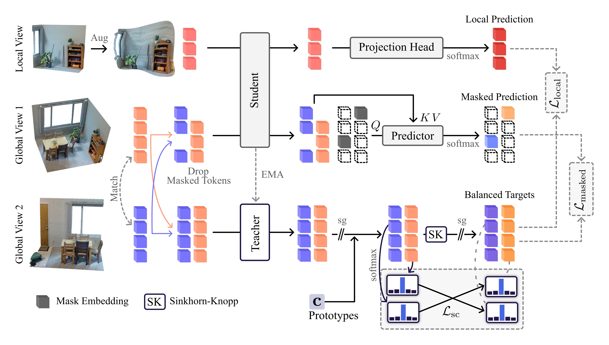

<h1 align="center">
  VINO: Revisiting 3D Representation Learning with Volume Transformers
</h1>

<p align="center">
  <a href="https://arxiv.org/abs/2611.07176">Paper</a>
  ·
  <a href="https://adriankruse.github.io/VINO/">Project Page</a>
  ·
  <a href="https://huggingface.co/adrkruse/VINO">Weights</a>
  ·
  <a href="#citation">BibTeX</a>
</p>

Official code for [VINO: Revisiting 3D Representation Learning with Volume Transformers](https://arxiv.org/abs/2611.07176).
VINO pre-trains [Volume Transformer (Volt)](https://github.com/YilmazKadir/Volt) backbones without labels, separately
for indoor and outdoor point clouds. This repository has the pre-trained weights, a quick start for extracting
features, and our evaluations. The pre-training code will be released later.

The code builds on [Volt](https://github.com/YilmazKadir/Volt/blob/8dcd608a4d9e75e17005b85c65f8517f2cf9be50) and
[Pointcept](https://github.com/Pointcept/Pointcept/blob/04a0232b70f5c7091ffdc6bfe7a476e3eb7daff2), with instance
segmentation components from
[SGIFormer](https://github.com/RayYoh/SGIFormer/blob/4c05d57bbbd676b6a2398b03deac916e603a9dd7).

<p align="center">
  
</p>

## Setup

We recommend [`uv`](https://docs.astral.sh/uv/) to install the environment:
```bash
curl -LsSf https://astral.sh/uv/install.sh | sh
# Load CUDA 12.6 first. This creates a virtual environment (.venv) with the dependencies from pyproject.toml
uv sync
source .venv/bin/activate
```

## Weights

Download the pre-trained backbones from [Hugging Face](https://huggingface.co/adrkruse/VINO):
```bash
hf download adrkruse/VINO --local-dir weights/vino
```
Use `vino_indoor_stage2.pth` for ScanNet, ScanNet200, ScanNet++, NYUv2 and registration, and `vino_outdoor_stage2.pth`
for nuScenes, SemanticKITTI and Waymo. The `stage1` checkpoints are the backbones before 2D-to-3D distillation.

Fine-tuning on ScanNet, ScanNet200 and ScanNet++ also distills from Volt's U-Net teachers:
```bash
hf download KadirYilmaz/Volt --include "teacher_weights/scannet*_unet_teacher.pth" --local-dir weights
```

## Quick start

Features for your own point cloud, with `coord`, `color` (0-255) and `normal` as numpy arrays of shape (N, 3):
```python
import torch
from huggingface_hub import hf_hub_download
from pointcept.datasets.transform import Compose
from pointcept.models.volt import Volt

model = Volt(
    in_channels=6, embed_dim=768, depth=12, num_heads=12, mlp_ratio=4, init_values=1e-5, qk_norm=True,
    up_mlp_dim=None, num_register_tokens=16, tokenizer_mean_pool=True,
)
model.load_state_dict(torch.load(hf_hub_download("adrkruse/VINO", "vino_indoor_stage2.pth"))["state_dict"])
model = model.cuda().eval()

transform = Compose([
    dict(type="CenterShift", apply_z=True),
    dict(type="GridSample", grid_size=0.02, hash_type="fnv", mode="train", return_grid_coord=True, return_inverse=True),
    dict(type="CenterColor"),
    dict(type="ToTensor"),
    dict(type="Collect", keys=("grid_coord", "inverse"), feat_keys=("color", "normal")),
])
point = transform(dict(coord=coord, color=color, normal=normal))
point = {key: value.cuda() for key, value in point.items()}
point["batch"] = torch.zeros(len(point["grid_coord"]), dtype=torch.long, device="cuda")
with torch.no_grad():
    feat = model(point)  # (M, 768), M occupied 2 cm voxels; voxels in the same 5x5x5 token share one vector
point_feat = feat[point["inverse"]]  # (N, 768), mapped back to the input points
```

For the outdoor checkpoint, use `in_channels=7`, `vino_outdoor_stage2.pth` and the transform below, with the LiDAR
intensity scaled to [0, 1] as `strength` of shape (N, 1). Normals are estimated from the points.
```python
transform = Compose([
    dict(type="EstimateNormal"),
    dict(type="CenterShift", apply_z=True),
    dict(type="GridSample", grid_size=0.05, hash_type="fnv", mode="train", return_grid_coord=True, return_inverse=True),
    dict(type="NormalToProj"),
    dict(type="ToTensor"),
    dict(type="Collect", keys=("grid_coord", "inverse"), feat_keys=("strength", "proj")),
])
point = transform(dict(coord=coord, strength=strength))
```

## Data

ScanNet, ScanNet200, ScanNet++, nuScenes, SemanticKITTI and Waymo are prepared exactly as in
[Volt](https://github.com/YilmazKadir/Volt#data-preprocessing). SPFormer also needs superpoints: for ScanNet, run the
superpoint script from Volt's instance segmentation section; the ScanNet++ preprocessing writes them itself. Put the
processed datasets (or links to them) under `data/`: `scannet` (also used for ScanNet200), `scannetpp`, `nuscenes`,
`semantic_kitti` and `waymo`.

### NYUv2
Download the labelled NYUv2 frames, the official splits and the 40-class mapping:
```bash
wget -P data/nyuv2 https://horatio.cs.nyu.edu/mit/silberman/nyu_depth_v2/nyu_depth_v2_labeled.mat
wget -P data/nyuv2 https://horatio.cs.nyu.edu/mit/silberman/indoor_seg_sup/splits.mat
wget -P data/nyuv2 https://raw.githubusercontent.com/ankurhanda/nyuv2-meta-data/master/classMapping40.mat
```
The images are lifted to point clouds with depth predicted by
[MoGe-3](https://github.com/microsoft/MoGe) (checkpoint [`Ruicheng/moge-3-vitg`](https://huggingface.co/Ruicheng/moge-3-vitg)).
MoGe-3 needs newer dependencies than this repository: install it in its own environment following its README (we used
commit `74fbce0`), add `h5py`, and run the script there:
```bash
python pointcept/datasets/preprocessing/nyuv2/preprocess_nyuv2_moge.py --checkpoint Ruicheng/moge-3-vitg
```

## Evaluation

Pass the pre-trained backbone with `-w`. For example, linear probing on ScanNet:
```bash
sh scripts/train.sh -g 4 -d scannet -c semseg-vino-lin -n semseg-vino-lin -w weights/vino/vino_indoor_stage2.pth
```

| Task | Config (`-c`) | Datasets (`-d`) |
| :--- | :--- | :--- |
| Semantic segmentation, linear probing | `semseg-vino-lin` | `scannet`, `scannet200`, `scannetpp`, `nyuv2`, `nuscenes`, `semantic_kitti`, `waymo` |
| Semantic segmentation, fine-tuning | `semseg-vino-ft` | `scannet`, `scannet200`, `scannetpp`, `nuscenes`, `semantic_kitti`, `waymo` |
| Instance segmentation, SPFormer | `insseg-spformer-vino` | `scannet`, `scannet200`, `scannetpp` |
| Instance segmentation, PointGroup, frozen backbone | `insseg-pointgroup-vino-lin` | `scannet`, `scannet200`, `scannetpp` |
| Instance segmentation, PointGroup, fine-tuned | `insseg-pointgroup-vino-ft` | `scannet`, `scannet200`, `scannetpp` |

Runs are written to `exp/<dataset>/<name>`. To evaluate a run's `model_best.pth` again:
```bash
sh scripts/test.sh -g 4 -d scannet -n semseg-vino-lin
```

For registration on 3DMatch and 3DLoMatch, see [`registration/README.md`](registration/README.md).

## License

The code is released under the [MIT License](LICENSE). The pre-trained weights have their own terms, see
[LICENSE.md](https://huggingface.co/adrkruse/VINO/blob/main/LICENSE.md): the outdoor checkpoints fall under the Waymo
Dataset License Agreement for Non-Commercial Use.

## Citation

```bibtex
@article{kruse2026vino,
  title   = {{VINO}: Revisiting 3D Representation Learning with Volume Transformers},
  author  = {Kruse, Adrian and Yilmaz, Kadir and de Geus, Daan and Engelmann, Francis and Leibe, Bastian},
  journal = {arXiv preprint arXiv:2611.07176},
  year    = {2026}
}
```
